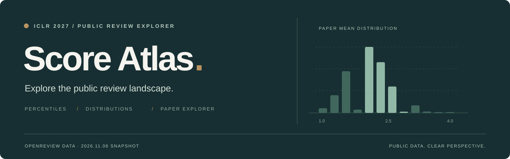
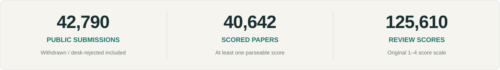
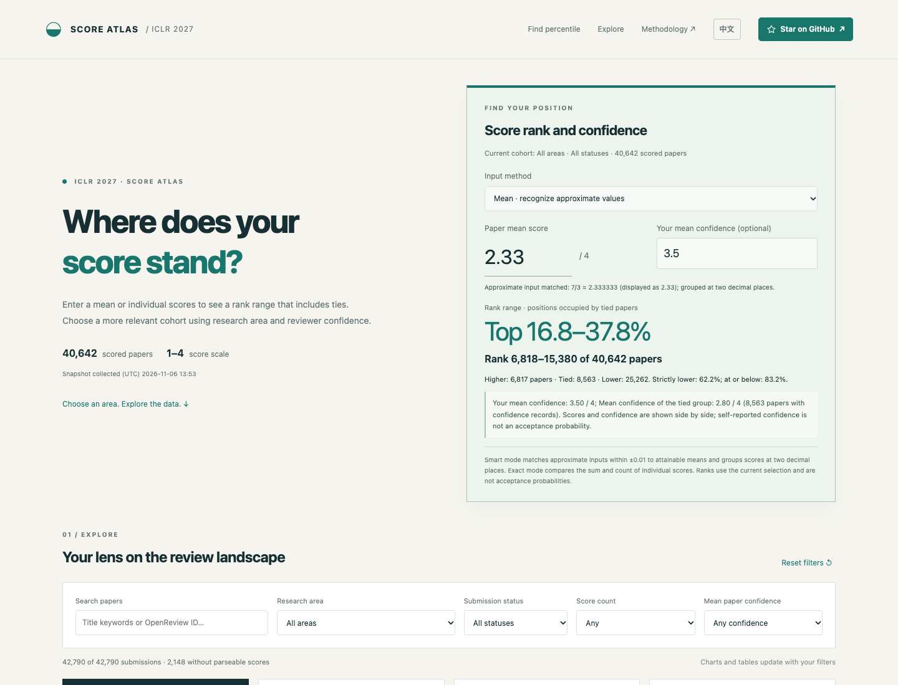

<p align="center">
  <a href="https://songjhpku.github.io/ICLR2027-statistics/">
    
  </a>
</p>

<h1 align="center">ICLR 2027 · Score Atlas</h1>

<p align="center">
  <strong>你的均分，排在什么位置？</strong><br>
  以公开评审数据为坐标，理解论文评分与领域分布。
</p>

<p align="center">
  <a href="https://songjhpku.github.io/ICLR2027-statistics/"></a>
  <a href="#数据与统计口径"></a>
  <a href="#本地使用与部署"></a>
</p>

<p align="center">
  <a href="https://songjhpku.github.io/ICLR2027-statistics/"><strong>中文体验 ↗</strong></a> &nbsp; · &nbsp;
  <a href="https://songjhpku.github.io/ICLR2027-statistics/en.html"><strong>English Demo ↗</strong></a> &nbsp; · &nbsp;
  <a href="#项目预览">项目预览</a> &nbsp; · &nbsp;
  <a href="#功能概览">功能概览</a> &nbsp; · &nbsp;
  <a href="#数据与统计口径">统计口径</a>
</p>

---

基于 **OpenReview 公开投稿与正式评审**的交互式统计工具。输入均分或逐条评分，查询含并列的排名区间；按领域、投稿状态、评分数量和论文平均置信度筛选。支持 2024–2026 初始档案的跨年量表对比、论文检索和 CSV 导出。所有计算在浏览器本地完成，无需登录。

<p align="center">
  
</p>

> [!NOTE]
> 当前数据采集于 **2026 年 11 月 6 日**，为静态快照。排名区间覆盖整个同分组，**不代表录用概率**。

## 项目预览

[](https://songjhpku.github.io/ICLR2027-statistics/en.html)

<p align="center"><sub>English edition · 真实页面截图 · 点击图片进入交互页面</sub></p>

## 功能概览

<table>
  <tr>
    <td width="50%" valign="top"><h3>01 &nbsp; 均分定位</h3>输入均分或逐条评分，查看同分组的名次区间；智能模式识别 2.33、2.66 等近似输入。</td>
    <td width="50%" valign="top"><h3>02 &nbsp; 分布总览</h3>从论文均分、逐条评分、评分与置信度热力图、评审分歧四个角度观察数据。</td>
  </tr>
  <tr>
    <td valign="top"><h3>03 &nbsp; 领域比较</h3>对比各研究领域的投稿规模、均分、中位数与评分构成，点击领域进一步筛选。</td>
    <td valign="top"><h3>04 &nbsp; 论文检索</h3>按标题关键词或 OpenReview ID 搜索，查看逐条评分，并跳转原始讨论页。</td>
  </tr>
  <tr>
    <td valign="top"><h3>05 &nbsp; 联动筛选</h3>组合研究领域、投稿状态、最低评分条数和最低平均置信度；图表、表格与排名随筛选同步更新。</td>
    <td valign="top"><h3>06 &nbsp; 结果导出</h3>将当前筛选结果导出为 CSV，包含论文信息、评分、置信度、分差与 OpenReview 链接。</td>
  </tr>
  <tr>
    <td valign="top"><h3>07 &nbsp; 置信度对照</h3>逐条评分与置信度并列展示，比较你的平均置信度与同分组的均值，并可按平均置信度筛选。</td>
    <td valign="top"><h3>08 &nbsp; 跨年对比</h3>将 2024–2026 公开初始档案按量表端点映射到 1–4 分，展示分布与均分差，并注明采集阶段和方法限制。</td>
  </tr>
</table>

## 开始使用

| 步骤 | 操作 |
| :--- | :--- |
| **01 · 输入均分** | 打开[中文页面](https://songjhpku.github.io/ICLR2027-statistics/#position)或 [English edition](https://songjhpku.github.io/ICLR2027-statistics/en.html#position)，选择均分或逐条评分输入，查看同分组的排名区间。 |
| **02 · 选择范围** | 在「探索数据 / Explore」中筛选研究领域、投稿状态、最低评分条数与最低论文平均置信度。 |
| **03 · 探索与导出** | 切换分布总览、领域比较、论文列表或跨年对比，按需下载筛选结果 CSV。 |

**比较范围提示：** 搜索条件同样会影响排名。跨年对比独立于上方筛选，使用各年完整的有评分样本。查看全体有评分论文中的位置前，请先点击「重置筛选 / Reset filters」。页面顶部可切换中文与英文。

## 数据与统计口径

### 快照信息

| 项目 | 说明 |
| :--- | :--- |
| 数据来源 | [OpenReview API v2](https://api2.openreview.net/notes) 中公开可见的投稿及正式评审（`Official_Review`） |
| 采集时间 · UTC | 2026-11-06 **13:41:06–13:53:25** |
| 采集时间 · 北京时间 | 2026-11-06 **21:41:06–21:53:25**（UTC+8） |
| 评分 / 置信度 | 均保留快照中观察到的 **1–4** 尺度 |
| 更新方式 | 数据内嵌于网页，页面不会实时请求 OpenReview |

投稿总数包含快照中可见的撤稿与初筛拒稿记录，不等同于官方最终投稿总量。采集跨越一段时间，**并非同一时刻的原子快照，也不代表初始评分**；后续评分或状态可能变化。

### 排名区间与小数输入

设当前比较范围内有 `N` 篇有评分论文，其中 `H` 篇分数更高、`E` 篇同分，则同分组占据 **第 H+1 至 H+E 名**，界面同时展示对应的前百分比区间。若没有同分论文，显示插入位置，不虚构并列。

- **智能均分模式（默认）**：根据当前快照的实际评分条数，列举 1–4 整数评分可产生的均分。在输入附近 ±0.01 内选择唯一最近值，并明确显示匹配结果；最终按两位小数分组。
- **严格两位小数模式**：不匹配近似值，将输入和论文均分都四舍五入到两位小数后比较。因此 2.66 和 2.67 可以不同。
- **逐条评分模式**：例如输入 `2, 2, 3`，用整数分数和与条数的交叉乘积判断大小与并列，避免浮点相等问题。

本次快照验证：`2.33` 和 `2.3333333` 在智能模式下对应 `7/3`，8,563 篇并列，占第 **6,818–15,380** 名；`2.66` 和 `2.67` 对应 `8/3`，4,231 篇并列，占第 **1,905–6,135** 名。精确输入 `2,3,3` 得到相同的后一个区间。

置信度按评审自评的 1–4 分展示。页面可比较你的平均置信度和同分组均值，或限定论文平均置信度下限；评分与置信度分开呈现，不自动生成加权分数。置信度不是正确概率或录用概率。

| 指标 | 计算规则 |
| :--- | :--- |
| 论文均分 | 从该论文可解析的逐条评分重新计算，缺失评分不计入。 |
| 论文层面统计 | 每篇有评分论文等权；逐条评分分布则按每条有效评分等权。 |
| 评审分歧 | 最高分减最低分，仅对至少有两条有效评分的论文计算。 |
| 无评分论文 | 保留在投稿列表与投稿总数中，不参与均分分布和百分位计算。 |

页面不提供录用预测；跨年档案比较并非同一论文的评分变化。与其他统计网站比较时，请核对采集时间、可见数据范围和筛选条件。更多说明见页面内的[统计口径](https://songjhpku.github.io/ICLR2027-statistics/#method)。

### 历史档案与映射

使用 [Paper Copilot OpenReview Archive](https://github.com/papercopilot/openreview/tree/a7ba4f2499bc630bb806703ceb754cf39daa4f85/venues/iclr) 的固定版本 `a7ba4f2499bc630bb806703ceb754cf39daa4f85` 中 `iclrYYYY.init.jsonl`。来源、SHA-256、样本数和精确均分频数记录在 [`src/history-summary.json`](src/history-summary.json)。

| 年份 | 有评分论文 | 原量表端点 | 原始论文均分 | 映射到 1–4 后 |
|---|---:|---|---:|---:|
| 2024 | 7,262 | 1–10 | 4.866 | 2.289 |
| 2025 | 11,520 | 1–10 | 4.779 | 2.260 |
| 2026 | 19,473 | 0–10 | 4.202 | 2.261 |
| 2027 | 40,642 | 1–4 | 2.058 | 2.058 |

映射公式：`1 + 3 × (原分 − 最小分) / (最大分 − 最小分)`。这是端点线性换算，并非官方或语义等价映射。尤其 2026 的最小评分是 **0**，不能按 1–10 换算。每篇有评分论文等权，保留有效 0 分、排除缺失评分。

2026 原档案有 19,634 行，其中 3 条是完全重复的无评分撤稿记录；去重后 19,631 篇。均分样本仍为 19,473 篇，不受这三条无评分记录影响。不同评分内容的同 ID 记录不会被静默去重。

**阶段限制：** 2024/2025 文件被档案标记为 `init`，未提供精确采集时刻；2026 `init` 与 `2025-11-13.11` 快照内容完全相同，已经进入讨论期。2027 为 11 月 6 日的讨论初期快照。它们不能统称为经核验的严格 rebuttal 前评分。

在这个映射下，2027 比 2026 的均分低约 **0.202**。该差值混合了投稿样本、评审群体、公开覆盖、讨论进度、量表语义等差异，不能单独归因于评分体系。历史比较不随上方筛选改变。

历史数据引用：Yang, Jing; Wei, Qiyao; Pei, Jiaxin. [Paper Copilot: Tracking the Evolution of Peer Review in AI Conferences](https://openreview.net/forum?id=CyKVrhNABo). ICLR 2026.

## 本地使用与部署

**下载 [`index.html`](index.html)（中文）或 [`en.html`](en.html)（英文），直接用浏览器打开即可。** 每个页面均内嵌界面、样式、脚本与同一份数据快照，无需安装依赖或构建。统计、筛选与 CSV 导出可离线使用；访问外部论文链接需要网络。

<details>
<summary><strong>克隆仓库</strong></summary>

```bash
git clone https://github.com/songjhPKU/ICLR2027-statistics.git
cd ICLR2027-statistics
```

随后用浏览器打开 `index.html` 或 `en.html`。离线切换语言时，请将两个文件保存在同一目录。

</details>

<details>
<summary><strong>发布到 GitHub Pages</strong></summary>

1. Fork 本仓库，或将 `index.html` 和 `en.html` 上传至你自己的仓库根目录。
2. 打开 **Settings → Pages**，将 Source 设为 **Deploy from a branch**。
3. 选择 **main** 分支与 **/(root)** 目录，点击 **Save**。
4. 等待部署完成，使用 Pages 页面显示的地址访问。

完整配置说明见 [GitHub Pages 官方文档](https://docs.github.com/en/pages/getting-started-with-github-pages/configuring-a-publishing-source-for-your-github-pages-site)。

</details>

<details>
<summary><strong>维护英文页面与仓库结构</strong></summary>

可读源码位于 `src/`。修改模板、样式或脚本后先生成中文独立页，再生成英文页；新文案需同步维护 `scripts/ui_translations.json`（旧翻译保留在 `build_en.py`）。原始 2027 逐条评分快照保持不变。

```bash
python3 scripts/build_site.py
python3 scripts/build_en.py
```

```text
.
├── index.html          # 中文独立网页与内嵌数据快照
├── en.html             # 英文独立网页，由脚本生成
├── src/                # 模板、样式、统计逻辑、2027 快照和历史汇总
├── scripts/            # 中文/英文生成与历史汇总脚本
├── tests/              # 数值回归及浏览器交互测试
├── .nojekyll           # GitHub Pages 静态文件标记
├── docs/assets/        # README 封面与页面预览
└── README.md           # 项目说明
```

</details>

## 开发验证

网页本身无需运行时依赖。开发验证使用 Node.js、Python 3 和本机 Chrome：

```bash
npm ci
npm test
npm run test:browser
```

复现历史汇总时，将 `src/history-summary.json` 中三个 `raw_url` 对应的固定版本文件下载为 `.cache/history/2024.init.jsonl`、`2025.init.jsonl`、`2026.init.jsonl`，然后执行 `python3 scripts/build_history.py`。脚本先核验 SHA-256，再汇总并去除完全重复记录；原始历史档案不提交到本仓库。随后运行 `npm run build` 更新两个独立页面。

浏览器测试可用 `CHROME_PATH` 指定 Chrome 可执行文件，默认使用 macOS 标准安装路径。覆盖两位小数近似输入、精确并列、置信度筛选、跨年汇总、中英文、CSV 和手机宽度。

## 来源与反馈

数据来自 [OpenReview](https://openreview.net/)，信息组织参考了 [Paper Copilot 的 ICLR 2027 汇总](https://papercopilot.com/paper-list/iclr-paper-list/iclr-2027-paper-list/)。本项目与 ICLR、OpenReview、Paper Copilot 无隶属关系。

如发现展示或统计问题，欢迎[提交 Issue](https://github.com/songjhPKU/ICLR2027-statistics/issues)，附上 **OpenReview ID、筛选条件与问题描述**，以便复现和核查。

---

<p align="center">
  <strong>Public data. Clear perspective.</strong><br>
  <sub>Built by <a href="https://github.com/songjhPKU">songjhPKU</a> · 如果这个项目对你有帮助，欢迎 Star 支持。</sub>
</p>
